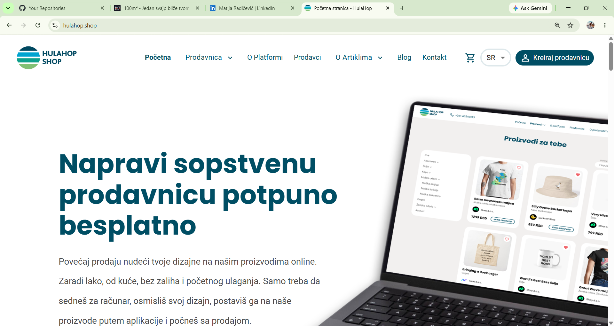

# HulaHop

HulaHop is a print-on-demand marketplace. Admins set up base garments, associates put their own designs on those garments and sell them through their own branded store, and customers browse, customize and buy. The interface is in Serbian by default, with English also available.

<p>
  
</p>

## How it works

| Role                        | What they do                                                                                                                                                                           |
| --------------------------- | -------------------------------------------------------------------------------------------------------------------------------------------------------------------------------------- |
| **Admin** (`ADMIN`)         | Manages base products (garments, colors, sizes, stock, print areas), categories, associates, orders, returns, withdrawals, reviews, blog, site appearance and translations.            |
| **Associate** (`ASSOCIATE`) | Uploads designs, places them on base products in the design editor (front and optionally back), sets up their brand store layout, and tracks orders, earnings and withdrawal requests. |
| **Customer** (`USER`)       | Shops across the platform or a specific associate's store (`/:storeId`), designs their own item, manages a cart and wish list, and checks out.                                         |

Two-sided designs cost extra. Each base product has a `double_design_price` surcharge, which the editor adds to the base price.

## Tech stack

|           | Backend (`backend/`)                                         | Frontend (`frontend/`)                |
| --------- | ------------------------------------------------------------ | ------------------------------------- |
| Framework | NestJS 10                                                    | React 18 + Vite                       |
| Language  | TypeScript                                                   | JavaScript (JSX)                      |
| Data      | MySQL via TypeORM                                            | Redux, Formik, axios                  |
| UI        | Swagger at `/swagger`                                        | MUI, Bootstrap, Konva (design editor) |
| Other     | JWT auth, sharp (WebP images), nodemailer + Handlebars, i18n | i18next                               |

The repo contains two independent npm packages and has no root `package.json`, so run each command from inside its package directory.

## Getting started

### Prerequisites

- Node.js 18 or later
- MySQL 8

### 1. Database

Create a database. Before loading the baseline schema, edit the seed admin row at the bottom of `backend/database/table.sql`: set your own email, and replace `<BCRYPT_HASH>` with the output of `node -e "console.log(require('bcrypt').hashSync('your-password', 10))"` (run inside `backend/` after `npm install`). Then load the schema and apply the later changes:

```bash
mysql -u <user> -p <database> < backend/database/table.sql
mysql -u <user> -p <database> < backend/database/alter-query.sql
```

> **Note:** These SQL files lag behind the TypeORM entities (for example, `products.double_design_price` is in neither). TypeORM `synchronize` is off and no migrations exist, so compare against `backend/src/**/entities/*.entity.ts` and add any missing columns by hand.

### 2. Backend

Create `backend/.env`:

```env
# Required: the server exits without these
DB_HOST=localhost
DB_USERNAME=root
ACCESS_SECRET_KEY=change-me
REFRESH_SECRET_KEY=change-me-too

# Optional
DB_PASSWORD=
DB_PORT=3306
DB_DATABASE=hulahop
APP_URL=http://localhost:5173      # used in password-reset links
SMTP_HOST=
SMTP_PORT=
SMTP_USER=
SMTP_PASS=
SMTP_SENDER=
SMTP_RECEIVER=
```

Then install and start it:

```bash
cd backend
npm install
npm run start:dev
```

The API runs on **http://localhost:3000**, with Swagger docs at http://localhost:3000/swagger. Uploaded images are stored in `./uploads` under the directory the server is started from.

### 3. Frontend

Create `frontend/.env`:

```env
VITE_BASE_SERVER_URL=http://localhost:3000
```

Then install and start it:

```bash
cd frontend
npm install
npm run dev
```

## Scripts

**Backend**

| Command                                   | Description                                                     |
| ----------------------------------------- | --------------------------------------------------------------- |
| `npm run start:dev`                       | Start in watch mode on port 3000                                |
| `npm run build`                           | Compile to `dist/`                                              |
| `npm run start:prod`                      | Run the compiled build                                          |
| `npx tsc --noEmit -p tsconfig.build.json` | Type-check                                                      |
| `npx eslint <file>`                       | Lint specific files (`npm run lint` runs `--fix` on everything) |

**Frontend**

| Command         | Description                 |
| --------------- | --------------------------- |
| `npm run dev`   | Vite dev server             |
| `npm run build` | Production build to `dist/` |
| `npm start`     | Serve the built `dist/`     |
| `npm run lint`  | ESLint                      |

## Project structure

```
hulahop-shop/
├── backend/
│   ├── database/           # table.sql (baseline) + alter-query.sql
│   └── src/
│       ├── core/           # global guards (JWT, roles), filters, data source
│       ├── i18n/           # en + sb translations served to the frontend
│       └── modules/        # one folder per feature: controller, service, dto, entities, repository
└── frontend/
    └── src/
        ├── components/     # shared UI, incl. PreviewJsonImage (design renderer)
        ├── locales/        # en + sr translations
        ├── routes/         # route constants and per-role route modules
        ├── utils/          # axiosInstance, constants
        └── views/
            ├── Admin/
            ├── Associats/
            ├── Users/      # public storefront
            └── Authentication/
```

## Development notes

- **Auth:** every API route requires a bearer token unless its handler is marked `@SkipAuth()`. Use `@Roles([...])` to restrict a route to certain roles.
- **API responses:** successful responses have the shape `{ data, message }`, so the frontend reads `response.data.data`. Errors have the shape `{ statusCode, message }`, and the axios interceptor already shows them as a toast.
- **Translations:** translation keys are the English source strings. Add every new string to all four files: `frontend/src/locales/{en,sr}/translation.json` and `backend/src/i18n/{en,sb}/translation.json`. At runtime the app loads translations from the backend.
- **Design editor:** two copies exist, one in `views/Admin/AssociatesProducts/EditProduct` and one in `views/Associats/Products/EditProduct`. A change to the editor usually needs to be made in both.
- **Login and logout** trigger a full page reload, because the routes and the auth header are set once when the app loads.
- **Product edits** recreate all variants and sub-variants, so their IDs change every time.

See [`CLAUDE.md`](CLAUDE.md) for more detailed architecture notes.

## Deployment

The backend includes a `vercel.json` that serves `dist/main.js`. Run it with `NODE_ENV=production`. In production, translations and mail templates are read relative to the working directory. The build only copies `i18n/**` into `dist/`, so the `.hbs` mail templates have to be made available separately.

The frontend builds to static files (`npm run build`), which can be served with `npm start` or by any static host.
